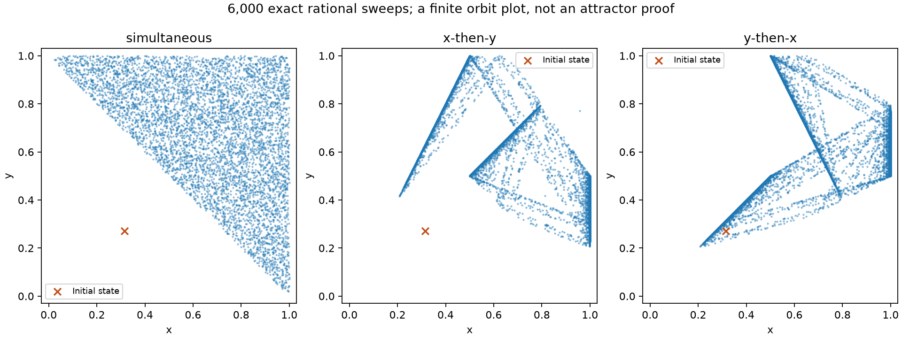

# Paradox dynamics

An executable reading companion to [Gary Mar and Patrick Grim, *Pattern and
Chaos: New Images in the Semantics of Paradox* (1991)](https://pgrim.org/articles/patternandchaos.pdf),
for the [SF Cog Sci Ingressing Minds reading group](https://github.com/m9h/sf-cogsci-ingressing-minds).

Explore how a rule for revising a sentence's numerical truth value becomes a
dynamical system. Start with an oscillation you can calculate by hand, compare
attracting and repelling fixed points, then examine the tent map and coupled
revision rules. Every experiment records its equation, initial values, arithmetic
and update order.

**Start without installing anything:** open the [executed notebook](examples/paradox_lab.ipynb)
or the [results guide](docs/results.md). The notebook also has an interactive
explorer when run locally. The [mathematical guide](docs/mathematics.md) explains
the equations and the distinction between a claimed value and a revised value.



## Run it

Requires Python 3.12+ and [uv](https://docs.astral.sh/uv/).

```sh
git clone https://github.com/m9h/paradox-dynamics.git
cd paradox-dynamics
uv sync --locked --extra test --extra notebook
uv run --locked paradox list
uv run --locked paradox simulate liar --initial 1/4 --steps 12 --precision rational --out scratch/liar --plot
uv run --locked paradox simulate chaotic-liar --initial 0.314 --steps 80 --precision float64 --out scratch/tent-float --plot
uv run --locked paradox simulate chaotic-liar --initial 0.314 --steps 80 --precision rational --out scratch/tent-exact --plot
uv run --locked paradox simulate dual-revision --initial 0.1 0.9 --steps 80 --precision rational --schedule x-then-y --out scratch/dual --plot
```

Each output directory contains `trajectory.json` and `trajectory.csv`; `--plot`
adds a time-series/cobweb or state-space figure. JSON includes source-code hashes,
package versions, input strings, represented values, the equation and the paper's
page reference. Exact fractions remain fractions in the data files; only rendering
converts them to floating point. Reusing an output directory replaces its files.

```python
from paradox_dynamics import simulate

run = simulate("k-sayer", "1/4", parameters={"k": "1/2"}, steps=12, precision="rational")
print(run.states[:4])
print(run.diagnostics())
```

Use strings for rational inputs: `"0.1"` means exactly one tenth. A Python float
has already been rounded, so the rational backend rejects float inputs.

## Experiments

| Experiment | What to look for |
|---|---|
| Simple Liar | `x → 1-x`: neutral two-cycles, with a fixed point at 1/2 |
| Truth-Teller / Samesayer | Keeping every estimate versus replacing it with 1 |
| k-Sayer / Minimalist | Attraction to 2/3 for the Half-Sayer; repulsion at the Minimalist's 2/3 |
| Chaotic Liar | The tent map: local expansion, special periodic orbits, and loss of information in binary arithmetic |
| Curry variation | A parameterized revision map; test its boundary cases before interpreting an orbit diagram |
| Simple Dualist | A period-four simultaneous update becomes period two under sequential revision |
| Dualist value-revision pair | Different state-space orbits for simultaneous, x-then-y, and y-then-x updates |

Paper locations and the precise equations are in [the mathematical guide](docs/mathematics.md).
The sequential convention for the paper's Simple Dualist is **y-then-x**; its
later value-revision example uses **x-then-y**. A step here is always one complete
sweep. Alternative schedules are explicit experiments, not interchangeable implementations.

## Precision is part of the experiment

The real tent map is expanding on each branch, but every binary floating-point
starting value is a dyadic rational. Repeated tent-map iteration eventually
exhausts those finite binary digits and reaches zero. An exact rational starting
value can have a different periodic orbit. Neither a collapsed machine trajectory
nor a single exact rational trajectory characterizes all real initial conditions.

The diagnostics report exact recurrences of the **stored states**, and, for scalar
maps, a finite-time average of `log(abs(f'(x)))`. They do not label an orbit chaotic.
A positive average also occurs on the tent map's repelling fixed point. Corners
and zero derivatives have explicit statuses instead of misleading finite numbers.

## Reproduce and check

```sh
uv run --locked --extra test pytest
uv run --locked --extra test ruff check .
uv run --locked python examples/reproduce.py --out scratch/reproduced
uv run --locked --extra notebook python examples/execute_notebook.py --output scratch/paradox_lab.ipynb
```

To use the widgets, open `examples/paradox_lab.ipynb` in a Jupyter-compatible
editor using this environment's Python kernel and run its cells. Widget packages
are optional; the saved notebook's ordinary figures can be read on GitHub.

Tests use exact closed forms, independently written semantic formulas, published
short trajectories and round-trip exports. See [validation](docs/validation.md).
This is a new implementation of selected equations, with original figures and
additional precision experiments; it does not claim to reproduce every figure,
fractal, or metamathematical argument in the paper.

Original code, prose and figures: [MIT](LICENSE). The linked paper retains its
own copyright and is not redistributed. The project explores the consequences
of specified semantics; deciding what these imply about cognition or ontology
requires further argument.
