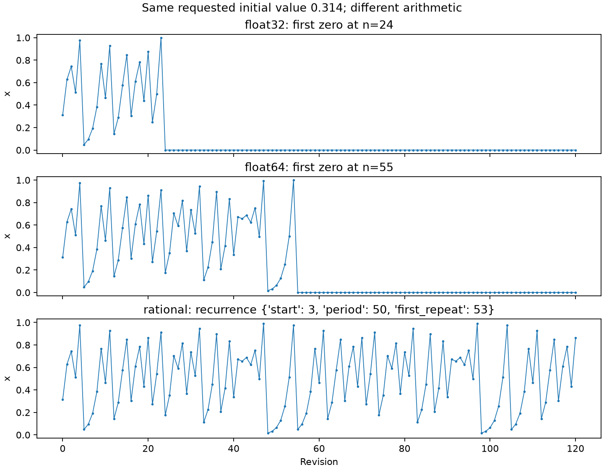
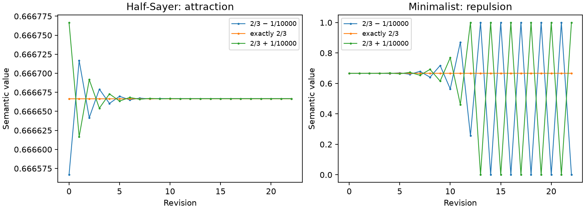
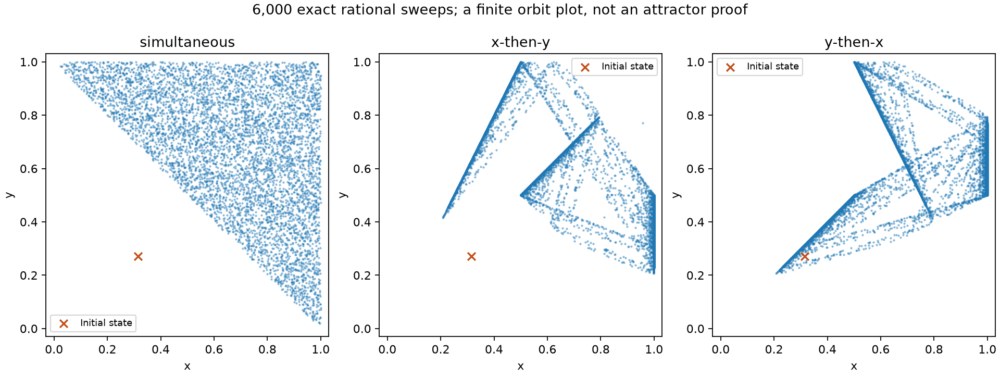

# What the experiments show

The [executed notebook](../examples/paradox_lab.ipynb) walks through the examples.
[summary.json](../results/summary.json) indexes **24 runs and seven original
figures**. Each named run directory contains a complete JSON trajectory with
provenance and a CSV version. These experiments are deterministic; no random
seed, hidden burn-in or stochastic noise is used.

## Arithmetic changes the observed tent orbit

All three runs request `x0="0.314"`. The float backends first round this decimal
to a binary value; the rational backend represents it exactly as `157/500`.

| Arithmetic | Result within 120 revisions | Data |
|---|---|---|
| float32 | Reaches zero at revision 24 and stays there | [JSON](../results/tent-float32/trajectory.json) |
| float64 | Reaches zero at revision 55 and stays there | [JSON](../results/tent-float64/trajectory.json) |
| Rational | Enters a 50-cycle at revision 3; first repeated state at 53 | [JSON](../results/tent-rational/trajectory.json) |



This is a comparison of representations of a requested input. The exact rational
orbit is an oracle for that rational initial condition, not a typical irrational
orbit. The dyadic-denominator argument in [the mathematical guide](mathematics.md)
explains why more binary precision delays the collapse without eliminating it.

## Local stability is separate from a fixed point's location

Both the Half-Sayer and Minimalist fix exactly `2/3`. Perturbations of `±1/10000`
shrink in the former and grow in the latter until the Minimalist enters the
endpoint two-cycle. The panels use different vertical scales to reveal the
small contraction on the left.



The exact Liar example produces a neutral two-cycle: [time series and cobweb](../results/liar.png).
The nearby tent starts `0.314` and `0.3141` reproduce the paper's twenty-step
table: [trajectories and separation](../results/sensitivity.png).

For another diagnostic control, the tent map started at exact `2/3` is stationary,
but its finite-time mean log derivative is `log(2)`.
[Recorded control](../results/tent-repelling-fixed-point/trajectory.json).
Positive local expansion alone does not classify the orbit as chaotic.

## Updating both sentences together differs from updating one first

The Simple Dualist started at `(1/4,1/8)` has period four under simultaneous
revision and period two after one transient sweep under either sequential order.
[Time series](../results/simple-dual-schedules.png).

The later value-revision pair gives the following state-space plots from the
same longer rational initial pair:

```text
x0 = 0.314159265358979323846
y0 = 0.271828182845904523536
```

Each panel uses 6,000 full sweeps and retains the whole trajectory. The orange
cross is the initial state, which may lie outside the subsequently visited region.
These starting values are our experiment, not the paper's figure settings.



No state repeats during these particular runs. That observation and the apparent
geometric structure do not prove an attractor or establish a chaotic invariant
measure. The three full datasets are
[simultaneous](../results/dual-long-simultaneous/trajectory.json),
[x-then-y](../results/dual-long-x-then-y/trajectory.json), and
[y-then-x](../results/dual-long-y-then-x/trajectory.json).

Starting instead from the short decimals `(0.1,0.9)` under x-then-y revision
produces a period-three exact rational orbit after 21 sweeps. Float32 and float64
do not repeat within our 200-sweep comparison. That difference is another reason
to preserve both input strings and arithmetic in a published result.
[Exact run](../results/dual-short-rational/trajectory.json).

## An equation-level discrepancy to discuss

For the Curry variation with `p=3/4` and `x0=1/5`, the exact trajectory enters
`17/20 ↔ 9/10` after three revisions. [Cobweb and time series](../results/curry.png).

At `p=1`, the displayed equation reduces to the identity; our `x0=0.23` control
stays at `0.23`. This disagrees with the nearby prose on printed p. 675 of the
paper. We document the algebra and test the equation, without silently changing
the model to fit that description. [Boundary-control data](../results/curry-boundary/trajectory.json).

## Scope

These results check selected revision maps and illustrate numerical and semantic
choices. They do not resolve the logical paradoxes or establish the broader
claims in *Ingressing Minds*. A useful reading-group exercise is to choose one
observation here and state exactly which assumptions are needed to obtain it.
